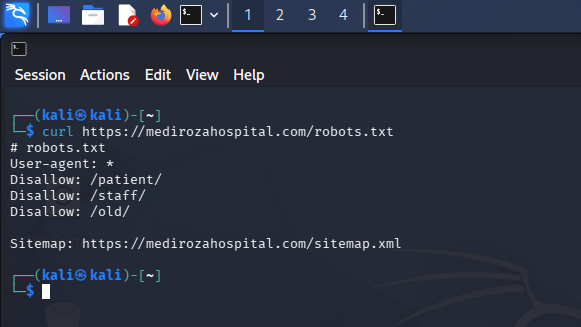
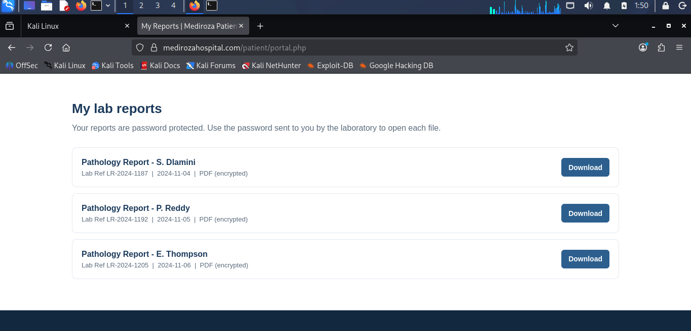
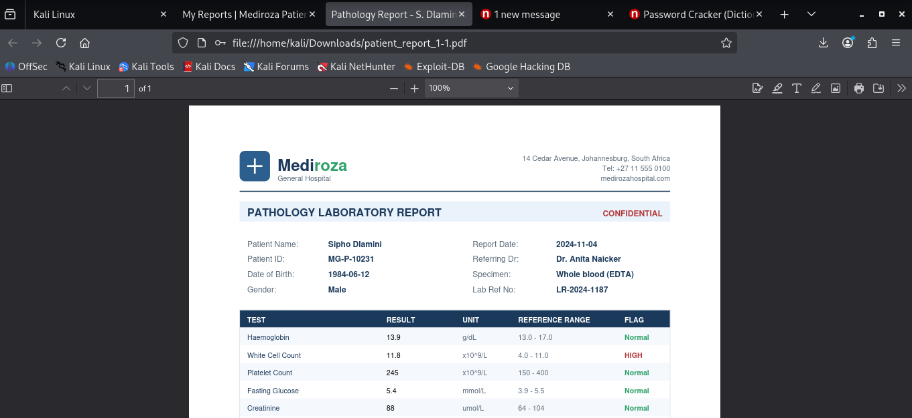
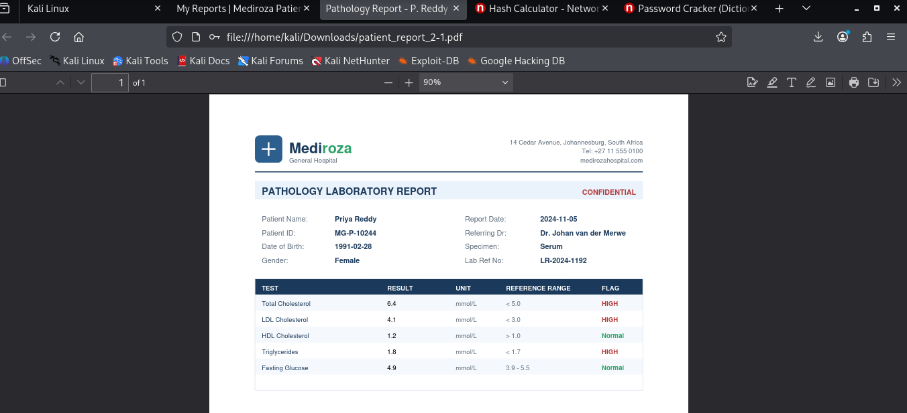
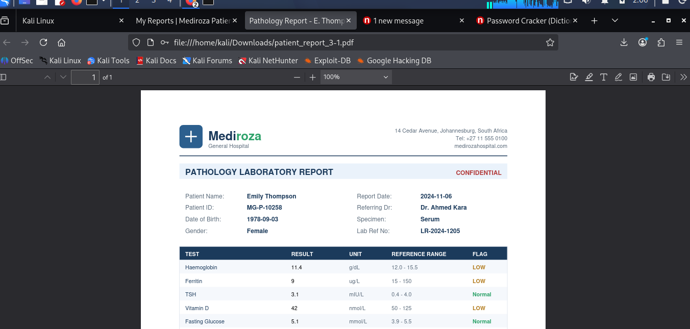
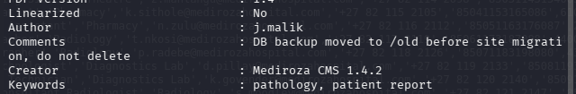
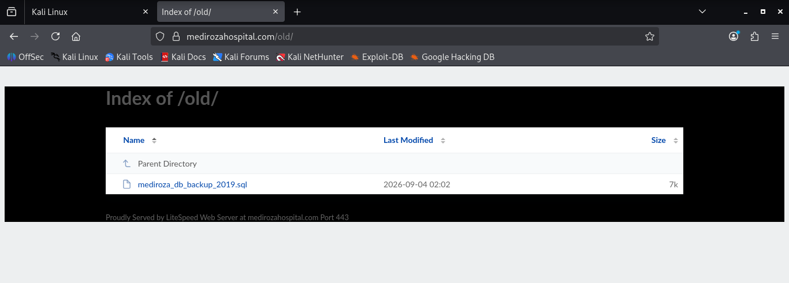
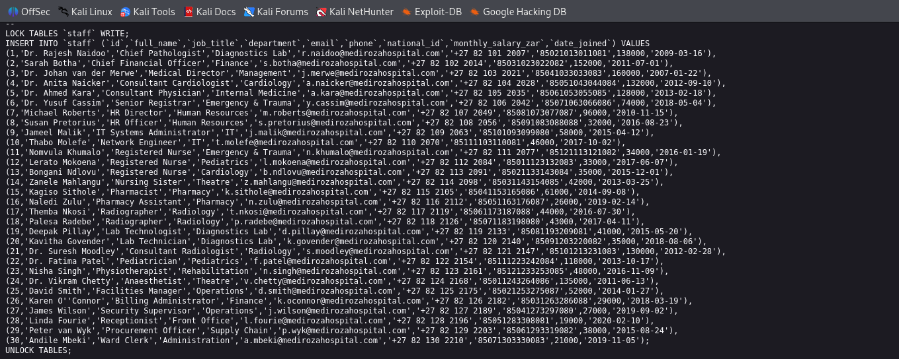

# Week 4 – Web Security Assessment of Mediroza Hospital

## 📌 Project Overview

As part of **Week 4 of my Cybersecurity & Ethical Hacking Internship at NetworkWalks**, I performed an authorized black-box web security assessment of the **Mediroza Hospital** practice website.

The objective of this assessment was to identify security weaknesses through reconnaissance, authentication testing, document analysis, metadata examination, and exposure of publicly accessible backup files.

All activities were performed within the authorized educational testing environment provided for the internship.


## 🎯 Objectives

* Perform reconnaissance on the assigned web application.
* Identify information exposed through `robots.txt`.
* Examine access to patient laboratory reports.
* Analyze password-protected PDF reports in the authorized environment.
* Decrypt an authorized PDF using QPDF.
* Examine PDF metadata using ExifTool.
* Investigate the `/old/` directory identified during reconnaissance.
* Identify an exposed database backup.
* Review existing staff information stored in the backup.
* Connect information from different findings to understand the complete security issue.

## 🛠️ Tools Used

| Tool        | Purpose                                          |
| ----------- | ------------------------------------------------ |
| Kali Linux  | Security testing and reconnaissance environment  |
| Web Browser | Accessing the authorized web application         |
| QPDF        | Decrypting the authorized password-protected PDF |
| ExifTool    | Extracting PDF metadata                          |
| Wget        | Downloading the authorized SQL backup            |
| Text Editor | Reading the SQL database backup                  |
| ChatGPT     | Converting SQL data into a human-readable format |

# 🔎 Activities Performed

## 1. Reconnaissance Using robots.txt

I began the assessment by examining the website's `robots.txt` file:

```text
https://medirozahospital.com/robots.txt
```

The file provided information about directories that were not intended to be indexed by search engines.

One of the important paths identified during reconnaissance was:

```text
/old/
```

This became an important clue for the later stages of the assessment.

### Screenshot



---

## 2. Login and Laboratory Report Access

I then accessed the authorized login functionality and navigated to the available laboratory reports.

The assessment involved examining how the application provided access to patient reports and identifying the protected documents available within the authorized environment.

### Screenshot



---

## 3. Patient PDF Reports

Three patient report PDFs were identified during the assessment.

The reports were:

* Patient Report 1
* Patient Report 2
* Patient Report 3

The PDF files were examined as part of the authorized security assessment.

### Report 1



### Report 2



### Report 3



---

## 4. PDF Password Analysis

The assessment showed that the PDF reports were protected with passwords.

For the authorized laboratory exercise, password testing was performed against the provided report using the supplied wordlist methodology.

The third report was successfully unlocked with the password identified during the exercise.

A clean unlocked copy was then created using QPDF:

```bash
qpdf --password='!@#$%^&' --decrypt patient_report_3.pdf report3_open.pdf
```

This unlocked copy was required for the next stage because metadata analysis needed access to the decrypted document.

---

## 5. PDF Metadata Analysis

After creating the unlocked PDF, I used **ExifTool** to examine its metadata.

Command used:

```bash
exiftool report3_open.pdf
```

The metadata contained information including:

```text
Author: j.malik
```

It also contained a comment referring to a database backup that had been moved to the `/old/` directory.

This was an important clue because the `/old/` directory had already been identified during the earlier reconnaissance stage.

### Screenshot



---

## 6. Investigation of the `/old/` Directory

The metadata clue was connected with the information previously discovered in `robots.txt`.

The following directory was examined:

```text
https://medirozahospital.com/old/
```

Directory listing was enabled, allowing files within the directory to be viewed.

An SQL database backup was exposed:

```text
mediroza_db_backup_2019.sql
```

This demonstrated how information discovered during different reconnaissance stages could be connected to identify a larger security issue.

---

## 7. SQL Database Backup

The exposed SQL backup was downloaded for analysis within the authorized testing environment.

The backup contained SQL statements used to recreate database tables and insert existing data.

The database contents were reviewed to understand what sensitive information had been exposed.

### Screenshot



---

## 8. Staff / Employee Data Analysis

The SQL backup contained existing staff information.

I extracted and presented the relevant staff data in a more readable format, including information such as:

* Staff name
* Job title
* Department
* Monthly salary

**No employee or staff information was added or modified by me.** The information shown was already present in the database backup.

### Screenshot



---

## 🔗 Connecting the Findings

One of the important lessons from this assessment was that individual clues could be connected together.

The assessment followed this chain:

```text
robots.txt
     ↓
/old/ directory discovered
     ↓
PDF report examined
     ↓
PDF metadata analyzed
     ↓
j.malik + database backup clue
     ↓
/old/ directory investigated
     ↓
SQL database backup exposed
     ↓
Staff information identified
```

This demonstrates why effective reconnaissance is not only about collecting individual pieces of information. It is also about understanding how those pieces relate to one another.

---

# ⚠️ Security Issues Identified

The assessment demonstrated several security weaknesses in the authorized practice environment, including:

1. Information disclosure through `robots.txt`
2. Weak password protection on PDF reports
3. Sensitive information contained in PDF metadata
4. Publicly accessible old/backup directory
5. Directory listing enabled on the backup directory
6. Database backup publicly accessible
7. Sensitive staff and organizational information stored in the exposed backup

These weaknesses could potentially lead to further information disclosure if they existed in a real production environment.

---

# 🧠 What I Learned

During Week 4, I learned:

* How reconnaissance information can provide useful clues for later testing.
* How `robots.txt` can reveal interesting application paths.
* How password-protected documents can be assessed in an authorized environment.
* How to use QPDF to create an unlocked copy of an authorized PDF.
* How to use ExifTool to examine document metadata.
* How metadata can unintentionally reveal useful information.
* How directory listing can expose files that should not be publicly accessible.
* How database backups can contain sensitive organizational information.
* How different findings can be connected to understand the complete attack path.
* The importance of performing security testing only with proper authorization.

---

# 📸 Evidence / Screenshots

| Screenshot          | Activity                           |
| ------------------- | ---------------------------------- |
| `1st-step.png`      | robots.txt reconnaissance          |
| `2nd-step.png`      | Login and laboratory report access |
| `1st-report.png`    | First patient report               |
| `2nd-report.png`    | Second patient report              |
| `3rd-report.png`    | Third patient report               |
| `metadata.png`      | PDF metadata analysis              |
| `sql.png`           | SQL database backup                |
| `employee-data.png` | Existing staff/employee data       |

---

# 🛡️ Security Recommendations

Based on the assessment, the following security improvements would help reduce the identified risks:

* Avoid exposing sensitive directories through public web servers.
* Disable directory listing where it is not required.
* Remove old database backups from public web directories.
* Store database backups outside the web root.
* Use strong and unique passwords for sensitive documents.
* Remove unnecessary metadata from documents before publication.
* Apply proper access controls to patient reports and sensitive files.
* Prevent sensitive internal information from being exposed through public resources.
* Regularly review backup locations and publicly accessible directories.

---

# 📚 Key Takeaway

This assessment demonstrated how a small piece of information discovered during reconnaissance can lead to additional findings.

The `/old/` path discovered through reconnaissance became important again when the PDF metadata referenced the same location. The exposed directory then revealed a database backup containing existing staff information.

The exercise helped me understand the importance of **deep reconnaissance, information correlation, metadata analysis, and secure handling of backup files** during a web security assessment.

---

## 🔐 Ethical & Authorized Testing

This assessment was performed as part of an authorized cybersecurity internship and educational laboratory exercise.

The techniques and tools used in this project should only be applied to systems where explicit permission has been provided by the owner.

---

## 👩‍💻 Author

**Sahara Nagarkoti**
**Roll No.: 41**
**Padma Kanya Multiple Campus**
**TU CSIT – 4th Semester**
**NetworkWalks Cybersecurity & Ethical Hacking Internship**

---

## 📅 Internship Progress

**Week 4 – Web Security Assessment / Deep Reconnaissance**

This week's work focused on moving beyond basic reconnaissance and understanding how exposed documents, metadata, directories, and database backups can be connected during an authorized security assessment.
